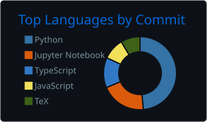
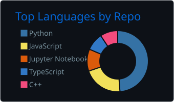

# Raghav-56

  
  <h1>Hi there! I'm Raghav Gupta</h1>

  

  
  &nbsp;&nbsp;
  

## About Me

- Interested in **Alignment via Interpretability** and **DevOps for Inference**
- Building projects across **Web**, **AI/ML**, and **Systems programming**
- Open to **collaborating** on interesting and impactful projects.
- I love **Programming**!
- I love **science and maths**! Learning in general is something I enjoy a lot.

You can view my [resume](https://raghav-56.github.io/Resume/).

  
You Interested?

### Alignment via Interpretability

I am fascinated by the idea of using interpretability techniques to understand and align large language models. I really believe that this will be a crucial area of research in the coming years, and I am excited to contribute to it in any way I can.

### DevOps for Inference

I have always been interested in the servers, git, bash, ssh, command line, remote machines, their usage and access.  
Having worked on AI projects, I naturally got interested in managing compute and infrastructure for AI workloads.

## Tech Stack

  
  
  
  
  

<b>Full Stack</b>

 

**Languages**: Python · C++ · Rust · Haskell · TypeScript · Bash · SQL · LaTeX · Scala

**ML / AI**: PyTorch · TensorFlow · HuggingFace · OpenCV · NeMo · LLaMA Factory · Whisper · Scikit-learn · WASM

**DevOps & Infra**: Docker · Git · GitHub Actions · GCP · Oracle Cloud · FastAPI · uvicorn · MLflow · Weights & Biases

**Environment**: Linux · SSH · UV · tmux · zsh · Neovim

 

  <strong>Published Packages:</strong> 
  
  &nbsp;
  

<!-- [PyPI](https://pypi.org/user/Raghav-56/) · [Npm](https://www.npmjs.com/~raghav-56) -->

<!-- PROJECTS_SECTION:START -->
## 🌟 Featured Projects

- [quartz_website](https://github.com/Raghav-56/quartz_website): Active repository by Raghav Gupta
- [loom-interiors](https://github.com/Raghav-56/loom-interiors): React interior-design frontend demo with camera style preview, draggable chat, and consultation briefs
- [attribute-flow](https://github.com/Raghav-56/attribute-flow): An interactive explainer for attribute grammars, dependency flows, proxy paths, cycles, and GATE-style MCQs.
- [laptopctl](https://github.com/Raghav-56/laptopctl): A small Linux laptop status and control utility
<!-- PROJECTS_SECTION:END -->

<!-- PROFILE_CARDS:START -->
## GitHub metrics

<b>Language charts</b>

  
  

<!-- PROFILE_CARDS:END -->

<b>More GitHub metrics</b>

Public GitHub data, updated daily. Outside-account work can include organizations I belong to.

  <picture>
    <source media="(max-width: 600px)" srcset="assets/github-trophies.svg#phone" />
    
  </picture>

<!-- QUOTE_SECTION:START -->
## Thoughts

> "Avoid administrative distraction."
<!-- QUOTE_SECTION:END -->

## Connect With Me

  
  
  
  
  

<!--START_SECTION:activity-->
1. 🎉 Merged PR [#4](https://github.com/Raghav-56/Raghav-56/pull/4) in [Raghav-56/Raghav-56](https://github.com/Raghav-56/Raghav-56)
2. 💪 Opened PR [#4](https://github.com/Raghav-56/Raghav-56/pull/4) in [Raghav-56/Raghav-56](https://github.com/Raghav-56/Raghav-56)
3. 🎉 Merged PR [#3](https://github.com/Raghav-56/Raghav-56/pull/3) in [Raghav-56/Raghav-56](https://github.com/Raghav-56/Raghav-56)
4. 🎉 Merged PR [#2](https://github.com/Raghav-56/Raghav-56/pull/2) in [Raghav-56/Raghav-56](https://github.com/Raghav-56/Raghav-56)
5. 💪 Opened PR [#3](https://github.com/Raghav-56/Raghav-56/pull/3) in [Raghav-56/Raghav-56](https://github.com/Raghav-56/Raghav-56)
<!--END_SECTION:activity-->

---

  

